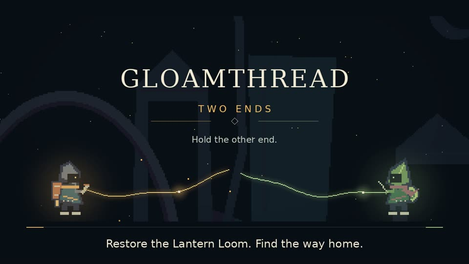

# Gloamthread — Two Ends

A pixel-art side-view fighter for **one or two players on one computer**. Survive twenty waves and four bosses in a world that grows as you play, buy your own upgrades between rounds, and keep going in endless mode. Draw your own fighter, or play the original two-player **Story Mode** with the couriers Tavi and Neri. No account or API key is needed to play. Combat runs locally; the browser downloads the game when you press Play.

[](https://github.com/9MidhunPM/GloamThread/releases/download/videos-2026-10-26/gloamthread-intro.mp4)

*Click the image to watch the 48-second intro (captioned). [All videos, transcripts and details](docs/VIDEOS.md).*

**[Play now at gloamthread.midhunpm.in](https://gloamthread.midhunpm.in)** · **[Browser guide](https://gloamthread.midhunpm.in/help.html)** · **[Player guide source](docs/PLAYER_GUIDE.md)** · **[Current release status](docs/STATUS.md)**

**Jump to:** [Browser play](#play-in-your-browser) · [Watch](#watch-the-game) · [Run from source](#play-in-three-steps) · [Controls](#controls) · [Accessibility](#accessibility) · [Modes](#what-you-can-play) · [Make a fighter](#draw-and-forge-a-fighter) · [Developers](#for-developers) · [Docs map](#documentation-map)

## Play in your browser

Explore the interactive 3D lantern-tree miniature, switch its Arena/Story preview, or turn motion off before playing. The current website release is **web-v0.6.1-resume**; [release checks and actual captures](evidence/web-portal/README.md) cover the website, generated guide and tested browser game.

1. Open the website in desktop Chrome/Chromium or Firefox and select **Play Gloamthread**.
2. Choose **SOLO RUN**, **LOCAL CO-OP** or **STORY MODE (2 PLAYERS)**. Each player needs a distinct keyboard zone or connected controller.
3. Use **Esc** to pause, the toolbar for fullscreen, and **Home → Resume game** to return to the website and reopen the same paused game.

Saves stay in that browser profile. Refresh ends the current run; clearing site data removes saved fighters, settings, scores and Story checkpoints. **Download fighter ZIP** backs up an accepted fighter, and **Import fighter ZIP** restores it; those ZIPs do not contain Story saves or settings. There is no cloud save sync or guaranteed offline reload. See the [save guide](docs/PLAYER_GUIDE.md#saves) and [browser troubleshooting](docs/PLAYER_GUIDE.md#troubleshooting).

Play is open; optional new fighter creation requires a personal invite. The [hosted Forge](server/README.md) keeps credentials and private drafts on the server. Built-in and accepted fighters need no authoring service to play. Mobile touch controls and online multiplayer are outside this release. The website motion control is separate from the game's reduced flash/shake settings.

## Watch the game

Every gameplay video is a real engine capture of the game's own automated demo scripts (no human players, no editing). Download or stream them from the [videos release](https://github.com/9MidhunPM/GloamThread/releases/tag/videos-2026-10-26).

| Video | Length | What it shows |
| --- | --- | --- |
| [Intro](https://github.com/9MidhunPM/GloamThread/releases/download/videos-2026-10-26/gloamthread-intro.mp4) | 0:48 | Story introduction with burned-in captions ([transcript](docs/VIDEOS.md#intro)). Also kept in this repository at [docs/media/gloamthread-intro.mp4](docs/media/gloamthread-intro.mp4). |
| [Arena highlights](https://github.com/9MidhunPM/GloamThread/releases/download/videos-2026-10-26/gloamthread-arena-highlights.mp4) | 2:23 | Co-op combat, shops, split cameras, all four bosses, endless and a 32-enemy crowd. |
| [Full 25-wave run at 4×](https://github.com/9MidhunPM/GloamThread/releases/download/videos-2026-10-26/gloamthread-arena-full25-4x.mp4) | 7:57 | One uninterrupted run from wave 1 to endless wave 25 with earned upgrades (includes some bot wandering between waves). |
| [Entire Story Mode](https://github.com/9MidhunPM/GloamThread/releases/download/videos-2026-10-26/gloamthread-story-full.mp4) | 3:51 | All eight rooms, dialogue, bridges, the Spoolwarden boss, the secret and the ending. |
| [Accessibility tour](https://github.com/9MidhunPM/GloamThread/releases/download/videos-2026-10-26/gloamthread-accessibility.mp4) | 1:01 | Settings, remapping, assists, high contrast and toggle-attack in a run. |

Prefer to watch it live on your own machine? See [watch the automated demos](#watch-the-automated-demos-yourself).

## Play in three steps

You need a 64-bit computer with OpenGL 3.3 graphics. The game is developed and tested on Linux; Godot also runs it on Windows and macOS, but those have not been tested.

1. **Install Godot 4.7.2 (standard, not .NET)** from [godotengine.org](https://godotengine.org/download) or your package manager (for example `sudo pacman -S godot` on Arch). Check with `godot --version`.
2. **Get the game:**

   ```sh
   git clone https://github.com/9MidhunPM/GloamThread.git
   cd GloamThread
   ```

   No Git? Use **Code → Download ZIP** on the GitHub page and extract it.
3. **Import once, then play** (from inside the `GloamThread` folder):

   ```sh
   godot --headless --path . --editor --import --quit
   godot --path .
   ```

The game opens fullscreen. **F11** switches to a window, or start windowed with `godot --path . --windowed --resolution 1920x1080`. On Wayland, add `--display-driver wayland` if the window does not appear; on X11 use `--display-driver x11`.

A ready-made [Linux package (v0.4)](https://github.com/9MidhunPM/GloamThread/releases/tag/v0.4.0-counterplay) needs no Godot install, but it is **older**: it lacks Story Mode, the accessibility options and the latest fighter generation. Use the source above for the current game.

## Controls

On the home screen choose **SOLO RUN** or **LOCAL CO-OP**, pick fighters and an input for each player, then **START RUN**. Menus also work with the mouse.

| Action | Player 1 (left keyboard) | Player 2 (right keyboard) | Gamepad |
| --- | --- | --- | --- |
| Move | A / D (W / S up/down) | Arrow keys | Left stick or D-pad |
| Jump (Down + Jump drops through a plank) | Space | Period `.` | A |
| Attack (hold to repeat, or set to toggle) | F | Comma `,` | X |
| Special ability | G | Slash `/` | B |
| Dodge | Left Shift | Apostrophe `'` | RB |
| Revive partner (hold) / reopen your shop | E | M | Y |
| Pause | Escape | Enter | Start |

**Every action except Pause can be remapped** in **SETTINGS & CONTROLS**. In Solo Run, P1 can switch to the right-hand keyboard side with the lobby's **P1 INPUT** button. Two players sharing one keyboard depend on how many keys it can report at once; a gamepad avoids that. Story Mode uses the same layout plus a map key (Tab / Semicolon / Select); see the [Player Guide](docs/PLAYER_GUIDE.md#3-inputs-menus-and-joining).

## Accessibility

Open **SETTINGS & CONTROLS** from the home screen or the pause menu. Assists, toggle attack, high contrast and narration start off; game speed and damage taken start at 100%. Settings are saved separately from your run.

- **Remap actions except Pause** per player, for keyboard or gamepad, with clash protection and a gamepad stick deadzone.
- **Press-to-toggle attack** per player, so nothing has to be held down.
- **Game speed** 100 / 80 / 60% and **damage taken** 100 / 75 / 50 / 25% assists (runs are labelled *assisted*, nothing is locked).
- **High contrast** menus and HUD; player markers are labelled **P1/P2**, never colour-only.
- **Read menus aloud** through your system's text-to-speech voice.
- **Reduced flash**, **reduced shake**, and separate **master / music / effects** volume.
- Full keyboard, gamepad or mouse menu navigation; every option explains itself on screen.

Details, one-handed layouts, narration setup and known limits: **[Accessibility guide](docs/ACCESSIBILITY.md)**.

## What you can play

| Mode | Players | In short |
| --- | --- | --- |
| **SOLO RUN / LOCAL CO-OP** | 1–2 | Twenty waves, bosses at 5/10/15/20, then optional endless. Personal coins and shops; every active player must press Ready. The world grows from four to sixteen screens after waves 5/10/15, with caves, caches and healing plants. The camera splits when partners explore apart. Run upgrades reset when the run ends; fighters, settings and scores are kept. |
| **STORY MODE (2 PLAYERS)** | 2 | The original eight-room adventure: restore paired bridges, beat the Spoolwarden, unlock the shared dash and bring the Lantern Loom home. Its title and pause menus return to the arena. |
| **CHARACTER FORGE** | — | Draw or import a fighter, choose one of three body types and six ability families, preview its animation and accept it into your library. |

Enemies telegraph their attacks: chargers mark a rush lane, heavies guard their front, shooters lock a three-shot burst and flyers mark their dive. [Enemy guide](docs/ENEMY_MECHANICS.md). Saved fighters, settings and scores live in browser storage on the website, or in Godot's per-user data folder under `Gloamthread-Arena` for native play.

## Draw and forge a fighter

Three built-in fighters (including the AI-generated Kiln Fox) and any fighter you have accepted work offline. Character Forge offers a drawing canvas, PNG/JPEG import, editable body/ability/theme proposals, an animation preview and local correction tools. Name your fighter before analysing: names and weapon descriptions guide the artwork, and magic identities get projectile kits while sword/spear fighters get melee kits.

On the website, enter your personal creator invite in **Character Forge**, then draw or upload original art. Review the proposal, generate, preview and accept. Download the fighter ZIP to keep a backup. The server holds the provider key and retained private drafts; your browser stores accepted fighters. Cached crop/mask/pivot corrections send no model request. Follow the [browser creation and backup steps](docs/PLAYER_GUIDE.md#create-a-fighter).

For **native desktop authoring**, generating new artwork is optional and uses **your own OpenAI API key** through a local Python helper:

```sh
python3 -m venv --system-site-packages .venv
.venv/bin/python -m pip install -r requirements-authoring.txt
.venv/bin/python tools/fighter_forge.py status
```

Put `OPENAI_API_KEY` in the ignored root `.env` (see `.env.example`); never commit it or paste it into chat. Godot launches the helper without reading the key. Analysis uses `gpt-6-luna`; images use `gpt-image-1-mini` at low quality. Analyse and Generate are explicit actions with no automatic retries or model fallback, every result is validated before acceptance, and no provider call happens during play. The user removed the local dollar caps; request estimates remain as history, not billing receipts. Cached crop/mask corrections are local and free. Full workflow: [Player Guide §6](docs/PLAYER_GUIDE.md#6-make-an-arena-fighter) and [worker details](evidence/arena-content/forge/README.md).

## For developers

### Watch the automated demos yourself

```sh
./showcase.sh                    # arena highlights: bosses, endless, crowd finale
./showcase.sh --full --speed 2   # the full 25-wave run with normal progression
./story_showcase.sh              # the entire Story Mode, start to ending
godot --path . --script tools/accessibility_tour.gd   # one-minute settings tour
```

**Space** pauses, **1/2/4** change speed, **N** skips a highlight chapter and **Esc** quits. Demos use temporary saves and never touch yours. Add `--record video.ogv` to either showcase script to save a 1920×1080 video with sound through Godot's Movie Maker. Options: [arena showcase](docs/SHOWCASE.md), [story showcase](docs/STORY_SHOWCASE.md); how the published videos were made: [recording evidence](evidence/recordings/README.md).

### Verify

```sh
python3 tools/check_pack.py
python3 -m unittest discover -s tools/tests -p 'test_*.py'
python3 -m tools.forge.content --validate
python3 -m tools.forge.retained --validate
python3 -m tools.forge.world --validate
python3 -m tools.forge.scenery --validate
godot --headless --path . --editor --import --quit
godot --headless --fixed-fps 60 --path . --script tests/arena/run_tests.gd
godot --headless --fixed-fps 60 --path . --script tests/forge/run_tests.gd
godot --headless --fixed-fps 60 --path . --script tests/forge/browser_tests.gd
```

Current results, resolved historical failures and remaining verification limits are recorded in [STATUS](docs/STATUS.md). Rebuild original arena media only deliberately with `python3 -m tools.forge.content --build --validate`. Package a clean committed checkout with `python3 tools/package_arena.py` ([packaging guide](docs/ARENA_DEMO.md)). Automated checks and bot routes do not prove rendered quality, physical controllers or enjoyable human play.

## Documentation map

| Read this | For |
| --- | --- |
| [Player Guide](docs/PLAYER_GUIDE.md) | Start in the browser, learn modes/controls, create and back up fighters, or fix a problem |
| [Accessibility guide](docs/ACCESSIBILITY.md) | Every accessibility option and its limits |
| [Videos](docs/VIDEOS.md) | All videos, the intro transcript and how each was made |
| [Final review desk](docs/FINAL_REVIEW.md) | A three-minute demo route and the real screenshot gallery |
| [Web release and operations](docs/WEB_RELEASE.md) | Build and serve the website/game, deploy hosted Forge and manage private server backups |
| [Status](docs/STATUS.md) | What is implemented and verified, and what is not |
| [Wave fighter spec](docs/WAVE_FIGHTER_SPEC.md) · [Scrolling world plan](docs/SCROLLING_WORLD_PLAN.md) | Approved design contracts |
| [Enemy mechanics](docs/ENEMY_MECHANICS.md) | How each enemy telegraphs and how to counter it |
| [AI asset workflow](docs/AI_ASSET_WORKFLOW.md) | Generation, correction and provenance rules |
| [CHANGELOG](CHANGELOG.md) · [AI_USAGE](AI_USAGE.md) · [SUBMISSION](SUBMISSION.md) | Development record |

## Real gameplay gallery


Capture versions and controlled states are recorded in the [final review gallery](docs/FINAL_REVIEW.md); private player artwork is excluded.

## Project notes

Built with Godot 4.7.2 (MIT) in typed GDScript, with Python 3 authoring tools. All art, animation, music and sound are original or retained original generation with provenance; no resource packs ([notices](THIRD_PARTY_NOTICES.md)). Physical controllers, keyboard rollover, audio listening and fresh human playtests remain unverified. The earlier eight-room game and its v0.1 release remain preserved in Git history and [release evidence](evidence/release/README.md). Event guidance: **Devin Hack Kochi** in [RULES.md](RULES.md).
