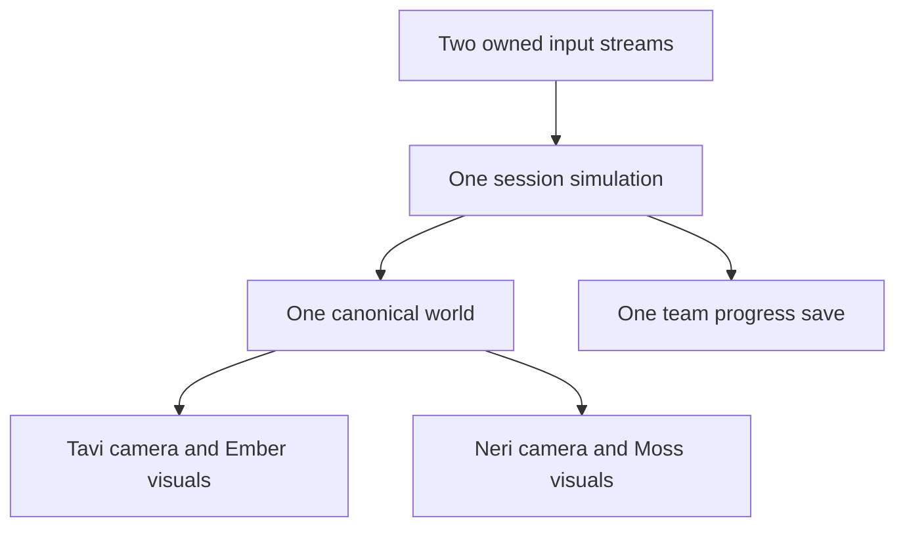

# Gloamthread: Two Ends — architecture plan

Version 2.0 · Planning contract, not an implemented Godot project.

Read [DECISIONS.md](DECISIONS.md) first. This document describes the smallest architecture that supports the fixed-character co-op slice and a later generated-content pipeline without making the slice depend on that pipeline.

## 1. Runtime boundary

Phase 1 is one desktop application, one process, one shared game session and one local save. It uses Godot 4.7.2 standard, typed GDScript, the Compatibility renderer and a fixed 60 Hz physics tick. Python generates and validates original content during development; Python is not required by a packaged game.

There is no account, server, database, network synchronization or live model call in Phase 1. Do not build those systems speculatively. Phase 2 may prepare an asset bundle through a separate service before a session starts; the game consumes a validated local bundle through the same manifest interface as fixed content.

The core separation is **game state → two presentations**. Rendering must not decide damage, collision, rewards or progression.

## 2. Scene composition

Use one application scene with a screen controller and a session scene. Menus, join flow, pause, map and ending are application states rather than independent copies inside each viewport.

The session presentation contains two equal `SubViewportContainer` areas. Each hosts a 480×360 `SubViewport` and one active `Camera2D`. Display their outputs side by side in a 960×360 logical composite. Overlay the divider, rather than reducing either view to accommodate it. Present the composite with integer scale and letterboxing; initial window target is 1920×720. Use nearest filtering on all pixel assets and viewport presentation.

One practical ownership arrangement is:

- The first SubViewport owns `WorldRoot`, the room instance, both player bodies and all enemies/triggers.
- The second SubViewport is assigned the first SubViewport's `world_2d` before cameras become active.
- The second camera exists beneath the second SubViewport and follows its assigned player's world position through an explicit reference.
- Each side has a separate HUD overlay attached to its display area, with its own player ID, hearts, special cooldown and revive status.
- The common pause/map/dialogue interface is drawn once above the composite.

Do not instantiate `WorldRoot` twice. Sharing a World2D does not justify two physics actors representing the same enemy. Both cameras show both couriers when their positions fall inside the respective view; neither camera filters the other player out.

Keep one active room for Phase 1. Two different camera positions inside that room are supported; independent travel into separate rooms is deferred.

## 3. Canonical geometry and theme visuals

Author room collision, entrances, anchors, hazards and actor spawn data once. A `RoomDefinition` uses stable logical tile IDs and world coordinates. Build canonical collision from those IDs, independently of whichever skin is visible.

Separate visual nodes into three groups:

| Group | Visibility bit | Contains |
| --- | ---: | --- |
| Common | 1 | Both couriers, enemies, attack warnings, hazard symbols, anchor states and essential interaction cues |
| Ember presentation | 2 | Ember terrain artwork, backgrounds, decoration and cosmetic particles |
| Moss presentation | 4 | Moss terrain artwork, backgrounds, decoration and cosmetic particles |

The first viewport renders Common + Ember; the second renders Common + Moss. Configure the relevant `CanvasItem.visibility_layer` and `Viewport.canvas_cull_mask` values deliberately. Ancestor visibility layers must also permit their children to render. Theme roots contain no collision bodies, damage areas, reward triggers, enemy AI or navigation generation.

Both skin maps derive their tile positions and visible solid outlines from the same canonical room data. Different textures may fill a platform, but cannot move its edge, disguise a hole as solid ground, or make a safe floor look lethal. Distinguish background decoration from foreground collision through contrast and contour. Keep danger shapes and timing consistent in both themes.

Start with original fixed Ember/Moss palettes and constrained texture variants. A per-viewport palette shader is an optional implementation choice, not a requirement. Keep critical cues outside its recolouring effect or reserve their palette entries. Do not change one global texture/material between drawing the two screens; each presentation owns any theme-specific resources it modifies.

## 4. Proposed repository layout

Create files only when their feature is being implemented. The following paths are a target structure, not files included as working game code in this pack.

| Path | Responsibility |
| --- | --- |
| `project.godot` | Pinned engine project, main scene, rendering/input defaults |
| `scenes/app/` | Boot, join, menu, pause, ending |
| `scenes/session/` | Split presentation, shared world owner, HUDs |
| `scenes/actors/` | Reusable player, two enemy types, Spoolwarden, Oru |
| `scenes/world/` | Room shell, checkpoints, anchor pairs, exits |
| `scripts/app/` | Application state and settings ownership |
| `scripts/session/` | Team progress, event routing, transition coordination |
| `scripts/input/` | Device assignment, bindings, per-player command snapshots |
| `scripts/actors/` | Movement, actor states and attacks |
| `scripts/world/` | Room loading, logical tiles, gates and triggers |
| `scripts/presentation/` | Cameras, theme layers, animation, HUD and effects |
| `scripts/persistence/` | Validated save/load and backup recovery |
| `content/` | Fixed profiles, rooms, world graph, dialogue and theme manifests |
| `assets/source/` | Original editable source data and selected generation originals |
| `assets/generated/` | Game-ready atlases, glyphs and WAV files |
| `tools/` | Asset generation and content validation |
| `tests/` | Built-in GDScript scenario runner and small fixtures |
| `evidence/` | Recorded verification commands, captures and playtest findings |

Prefer scenes, typed resources and small scripts over a generic ECS, plugin architecture or custom level editor. JSON can remain the source for inspectable data; convert it into validated typed resources at a narrow loading boundary if useful.

## 5. Module ownership and interfaces

| Owner | Inputs | Outputs / invariants |
| --- | --- | --- |
| `AppController` | Menu commands, focus and device events | One global mode; creates or closes a session |
| `InputRouter` | Physical device events and bindings | One command snapshot per joined player per physics tick |
| `GameSession` | Player commands, room events | Shared team progress and explicit session transitions |
| `PlayerController` | Own command snapshot and validated profile | Movement/attack state; never reads another device directly |
| `CombatResolver` | Attack/hurtbox contacts | Deduplicated damage, stagger and semantic combat events |
| `RoomDirector` | Current progress, validated room data | One room instance; atomic team transitions |
| `ThemePresenter` | Canonical room visuals and theme manifest | Render-only skin nodes; no gameplay side effects |
| `AudioDirector` | Semantic sound/music events | One bounded mix, one emission per event |
| `SaveRepository` | Serializable team progress | Valid checkpoint-based saves or a recoverable error |

Use direct references for local ownership and a small set of typed signals for cross-module events. Useful event identities include `actor_downed`, `actor_revived`, `enemy_defeated`, `anchor_latched`, `bridge_restored`, `team_ability_unlocked`, `checkpoint_activated`, `room_changed` and `loom_restored`. Do not create a generic global event bus with arbitrary string payloads before it is needed.

## 6. Input and global modes

At join, each player claims one device. A gamepad device may belong to only one player; the keyboard is one explicit device source. Support two gamepads and keyboard + gamepad first. Remapping belongs to the owned profile, not scattered key constants in actor code.

Translate inputs into named actions: move, jump, attack, special, interact, dash, pause and map. Snapshot both players before advancing gameplay. Preserve simultaneous holds and edge-triggered actions. Held interact is used for revive; interaction priority is revive → nearby objective/anchor → ordinary dialogue, with a visible prompt.

One player requesting pause or map pauses the whole session. Dialogue is also global in the slice; it cannot allow the other player to take unseen damage. Menu navigation has an explicit active owner so two controllers cannot accidentally select conflicting options. A disconnected assigned device pauses and offers reconnect/reassign; no automatic migration to the other player's device. Focus loss pauses; resuming is deliberate and clears stale input edges.

Pause gameplay actors, enemy timers, revive timers, invulnerability and encounter progression together. UI and reconnect detection continue processing. Use Godot's physics update and pause facilities rather than introducing a second custom simulation clock.

## 7. Player and combat state

Both players use one controller implementation with a validated `CharacterProfile`: sprite reference, maximum hearts, approved special ID and theme ID. Tavi/Neri are fixed input data in Phase 1. Required traversal abilities are team progress, not optional character equipment.

Keep a fixed compact player collider independent of sprite cell, cloth, wings, weapon and animation frame. Disable player-body blocking and friendly fire. Provide coyote time, jump buffering, variable jump height and predictable attack facing. Tune core movement equally before introducing extra movement differences.

Attacks have anticipation, active and recovery states, with a distinct attack ID. Record the targets already hit by each attack so a lingering overlap does not damage every tick. Spore Bolt is a real projectile with bounded lifetime and contacts; slow effects never alter physics step rate. Boss slow is capped or immune with visible feedback.

Threadstep unlocks for both players exactly once after the Spoolwarden victory, persists after failure and cannot be removed by changing future character profiles. Cross-stitch listens to a boss stagger window and a subsequent hit by the other player. It awards one capped burst per window. It is optional; ordinary attacks can finish the boss.

## 8. Downing, revive and team recovery

At zero hearts, a player enters Downed rather than becoming a second movable actor. Start a 12-second gameplay timer. A living partner can hold interact nearby for 1.5 seconds to revive at 2 hearts with brief immunity. Moving out of range, releasing interact or taking damage interrupts the rescuer's progress. These are initial tuning values.

Timeout, both players down, or a confirmed team checkpoint-recovery action triggers one recovery transaction. It clears temporary projectiles/effects and reloads the valid checkpoint room, restoring both players to their maximum hearts. Permanent unlocks, restored bridges, collected secret and defeated miniboss remain set. Transient enemies/encounter damage reset under a documented room policy.

After a boss is permanently defeated, do not respawn it or duplicate its reward on recovery. If both players die during the exact victory tick, resolve the boss reward/progression transaction once before entering recovery, then load the resulting valid progress.

## 9. Room transitions and restoration

Both living players must occupy the same exit rally zone; one presses interact to commit. Show which player is still needed. Reject transition if a player is down, the exit gate is locked, or a prior transition is already committing. Revive the partner or choose checkpoint recovery instead.

On commit: freeze gameplay commands, retain permanent progress, load the target room once, place both players at paired safe spawn positions, update cameras/themes, then release control. Failure to load retains or restores the previous safe state and reports the problem. Do not save an invalid target checkpoint.

Each Threadweave anchor pair has stable IDs and a predefined bridge result. Each player activates a different anchor; activations latch so one player can cross after both are connected. When the pair completes, record its permanent restored flag before emitting effects or autosave. Two simultaneous interactions cannot create two bridges.

Room graph reachability and physical traversal are separate checks. A link declared in JSON is not proof that both characters can jump or dash to it. The first required dash crossing is safe to retry, and both profiles must traverse all mandatory geometry.

## 10. Data contracts

Version every externally loaded manifest. Reject unknown required fields/IDs with useful diagnostics; allow only explicitly designated optional metadata. Resolve references before starting a session.

| Contract | Minimum fields | Required validation |
| --- | --- | --- |
| `CharacterProfile` | schema version, stable ID, display name, visual bundle ID, maximum hearts, special ID, theme ID | Approved special, tested stat ranges, fixed collider contract, asset/state coverage |
| `ThemeManifest` | version, stable ID, palette, logical tile mapping, background/decor references, critical-cue policy | All required tile slots exist; equal canonical geometry; supported image dimensions |
| `RoomDefinition` | version, room ID, bounds, canonical tiles, paired entrances, exits, spawn lists, checkpoints, anchor pairs | Unique IDs, in-bounds positions, valid references and safe spawns |
| `WorldDefinition` | version, start room, room references, gated links, progression rewards | Required reward before gate, reciprocal links where declared, no missing rooms |
| `AssetManifest` | version, asset ID/path, source, hash, dimensions, states/frames/pivots | Local path containment, files/hashes, frame bounds and original provenance |
| `TeamSave` | version, profile IDs, checkpoint ID, explored rooms, team unlocks, restored pairs, boss/secret flags | Known compatible IDs, valid checkpoint, supported schema and internally consistent flags |

Keep settings, controller bindings and volume outside `TeamSave`. Never persist live Node references, temporary enemy health or a raw physics-frame snapshot. Phase 2 adds bundle IDs and hashes; it does not replace the world's canonical data with model output.

## 11. Persistence and audio

Save at checkpoints and permanent progression transactions. Write a temporary file, verify its serializable shape, atomically replace the active save where supported, and retain the last-known-good backup. A write failure leaves the previous save intact and communicates that new progress is not yet durable.

Load at a safe checkpoint. Missing saves mean New Game; malformed or unsupported saves offer backup recovery or an explicit new game without silently overwriting the original. Validate save flags against fixed content, rather than accepting arbitrary ability names or room coordinates.

Emit audio events once from the shared simulation. Use one `AudioDirector` and one music timeline; two viewport listeners must not double-play hits or music. The slice can use a deliberately non-positional stereo mix. Keep music, effects and master volumes independent; important information also has visible cues.

## 12. Verification seams

The implementation must add a built-in GDScript runner under `tests/run_tests.gd`, callable headlessly without external test addons. Test through the session/room interface where possible: command snapshots in, observable actors/progress/events out. Avoid a mock for every node.

- Two owned inputs move only their assigned player, including simultaneous attacks.
- One enemy and one boss exist regardless of camera count; a shared hit/reward occurs once.
- Gates, anchor restoration, down/revive/recovery and room rallies obey both-player rules.
- Pause, focus loss and disconnect freeze all gameplay timers and clear stale input.
- Save/load and corrupt-save recovery preserve permanent team state.
- The same content bundle loads in headless scenarios and an actual rendered session.

Headless passes do not prove split-screen readability, camera feel, input hardware, animation, audio or performance. Record an actual two-device playthrough from a fresh save through the ending. Review both views simultaneously, test device removal, and measure frame behaviour in the busiest encounter. A normal-input route is required in addition to any debug-state tests.

## 13. Implementation checkpoints

1. One graybox room, two independently controlled bodies and two cameras sharing one world.
2. Fixed original profiles and both visual themes with identical terrain edges.
3. One encounter with real damage, down/revive, checkpoint recovery and pause.
4. One Threadweave bridge and a both-player room transition.
5. The Spoolwarden → shared Threadstep → previous gate → loom ending loop.
6. Eight-room assembly, complete original assets/audio, persistence and actual co-op evidence.

Do not create the Phase 2 service or expand toward 96 rooms before the fixed-character slice passes its acceptance gate.

## Primary technical references

- [Godot: Using Viewports](https://docs.godotengine.org/en/stable/tutorials/rendering/viewports.html) — shared World2D and cameras.
- [Godot: CanvasItem](https://docs.godotengine.org/en/stable/classes/class_canvasitem.html) — visibility layers and render properties.
- [Godot: Viewport](https://docs.godotengine.org/en/stable/classes/class_viewport.html) — canvas cull masks and listener options.
- [Godot: Multiple resolutions](https://docs.godotengine.org/en/stable/tutorials/rendering/multiple_resolutions.html) — integer presentation and stretch policy.

These URLs track stable documentation; the repository must record the exact tested engine version and consult its matching documentation when APIs differ.
