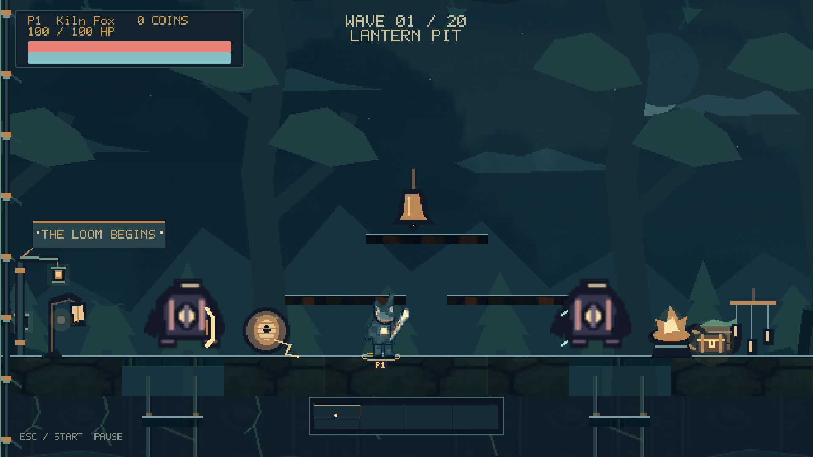
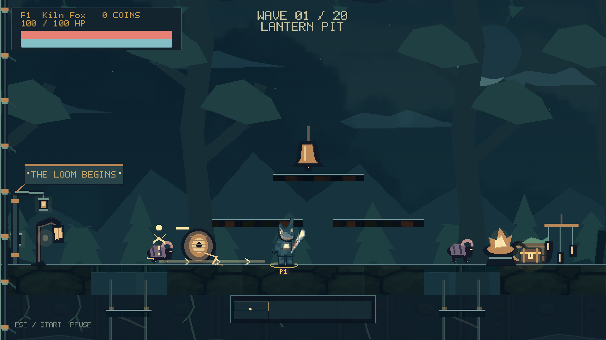

# Gloamthread — final review desk

Start here for a quick look at the playable modes, a short demo route and real screenshots. For complete controls and walkthroughs, open the [Player Guide](PLAYER_GUIDE.md). The project follows **Devin Hack Kochi** guidance.

## Launch the current source

Run this from any terminal directory with **Godot 4.7.2 standard**:

```sh
godot --path "/home/midhun/Coading/Gloamthread"
```

After a fresh checkout, import once if resources are missing:

```sh
godot --headless --path "/home/midhun/Coading/Gloamthread" --editor --import --quit
```

**Package version matters:** the previously published **v0.4.0-counterplay** package is an older arena-only build. Use the source above, or a later package whose home screen includes **STORY MODE (2 PLAYERS)**, to review the restored campaign. Check the package's `BUILD.json` for its exact source identity. From a newly extracted complete package, run `chmod +x ./Gloamthread.x86_64` and `./Gloamthread.x86_64`.

## What is available

| Mode | Review focus |
| --- | --- |
| **SOLO RUN / LOCAL CO-OP** | A scrolling wave fighter with personal coins/upgrades, four bosses, exploration, caches, dynamic shared/split views and optional endless. |
| **STORY MODE (2 PLAYERS)** | The original Tavi/Neri adventure: eight rooms, paired-anchor bridges, the Spoolwarden, shared Threadstep and a checkpoint-based journey home. |
| **CHARACTER FORGE** | Draw/import, review a name/body/ability/theme proposal, generate, correct cached crops, preview animation and accept an Arena fighter. |

Built-in and accepted fighters play offline. Forge has **no local total or per-character dollar cap**; explicit model actions still use your API account. Request estimates, uncertain outcomes, cache checks, cancellation and protection against automatic retries remain. Local crop/mask/pivot rebakes make no new model request.

## A suggested three-minute demo

This is a review route, not a measured human completion time. Story requires two active player slots. Give each a different keyboard zone or connected controller.

1. **Home → Arena lobby:** choose **SOLO RUN** or **LOCAL CO-OP**. Show fighter selection and the P1/P2 input assignments, then **START RUN**.
2. **Combat:** move, jump, hold basic attack and use a manual special. Show a marked enemy tell and leave its lane before activation. In co-op, explore apart to show the split views.
3. **First intermission:** after the wave clears, show a personal purchase or free reroll. Choose **EXPLORE** to close one panel; Interact reopens it. Every active player must become Ready to continue. If the first fight takes longer, use the gallery below to explain the shop without forcing a wave clear.
4. **Return home:** end the Arena run through its pause flow, then choose **STORY MODE (2 PLAYERS)**.
5. **Story title → New journey → join → Begin journey:** select distinct inputs, enter Lantern Rest and demonstrate both couriers. Use **Save and return to arena** from Story pause to show the return flow. **Return to title** instead opens the Story menu, whose **Back to arena** action returns home.

Arena defaults: P1 **A/D, Space, F, G, Shift, E**; P2 **arrows, Period, Comma, Slash, Apostrophe, M**. These mean move, jump, basic attack, special, dodge and interact/revive. Story uses the same basic layout, but Shift/Apostrophe is the **Threadstep unlock after the boss**. Its map is Tab/Semicolon. Full tables are in the [Player Guide](PLAYER_GUIDE.md#3-inputs-menus-and-joining).

## Real game capture gallery

Every image below is captured from the real engine. Captions distinguish selected documentation states, controlled gameplay setups and the original complete campaign route. These public starter captures illustrate the modes; the status record identifies the latest character-creation changes separately.

### Home and mode selection


Production home-menu capture. The Story entry identifies the build needed for this review.

### Arena lobby


Production lobby capture: choose a fighter and a distinct source for each active slot before starting.

### Scrolling co-op views


Retained controlled native scrolling-world setup. It illustrates P1-left/P2-right exploration views; it is not a new ordinary-input run.

### Personal shop and exploration


Retained controlled native setup. Coins and purchases are personal; Explore closes only the owner's shop panel.

### Restored Story entry


Fresh restored entry-flow capture: the actual Story button, New journey, join and Begin journey lead to this room. The documented capture session also exercised save-and-return. This establishes entry/return flow, not a fresh full eight-room human playthrough.

### Story bridge cooperation


Retained image from the original exported campaign route. Each courier activates a different anchor; bridge restoration is shared team progress. The complete original route remains historical evidence.

### Local layout correction


Production crop editor using retained public Kiln Fox artwork. Drag around each part and the whole-character master, check the opacity cutoff, then convert locally and inspect the animation before **Accept fighter & play**. No private player drawing or wizard output is shown.

### Heavy guard and counter window



Controlled real-engine counterplay capture. Bait the swing, flank the front guard or use a control/stagger counter; teal broken brackets show vulnerability.

### Charger commitment and recovery



Controlled real-engine counterplay capture. Leave the committed lane and punish the miss or wall recovery.

## Evidence and review boundaries

- [Current implementation and verification status](STATUS.md): authoritative commands, results, package identities and remaining acceptance.
- [Documentation and restored Story capture record](../evidence/docs-story/README.md): capture method, original image paths, hashes and limitations.
- [Enemy counterplay evidence](../evidence/enemy-counterplay/README.md): actual actor/physics checks and native cue captures.
- [Original campaign release evidence](../evidence/release/README.md): the earlier complete Story route, kept under its original scope.
- [Creator recovery evidence](../evidence/creator-recovery/README.md): local conversion/acceptance recovery, with private artwork excluded from publication.

Documentation captures select production UI states to make them readable. Existing automated routes and historical campaign results keep their original version/scope. Physical controllers, keyboard hardware rollover, fresh-human balance, listening quality and other hardware remain separate acceptance questions. Confirm the final integration/package identity in the status and release records before treating a downloaded build as this exact source.
