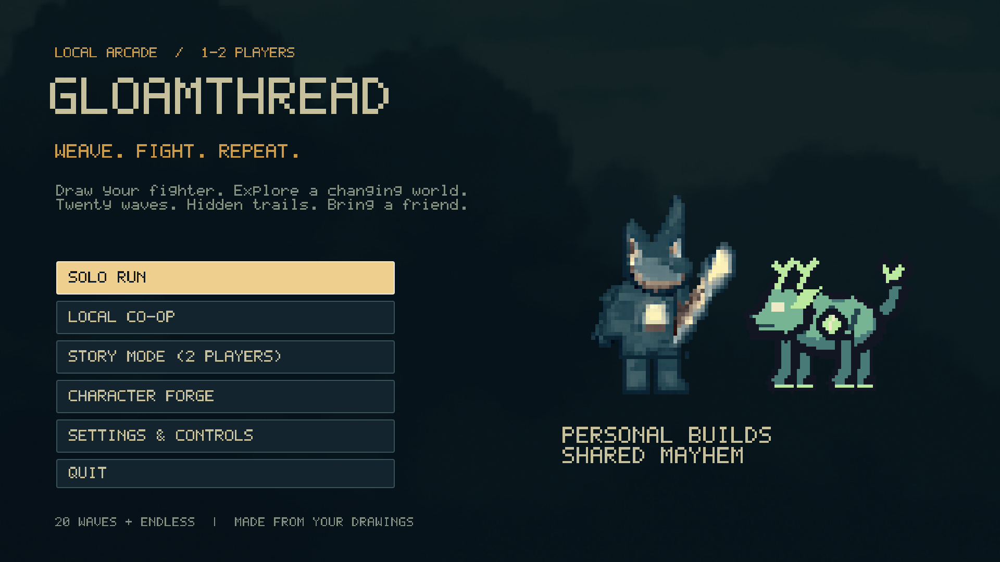
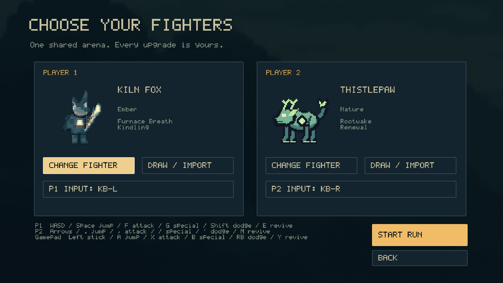
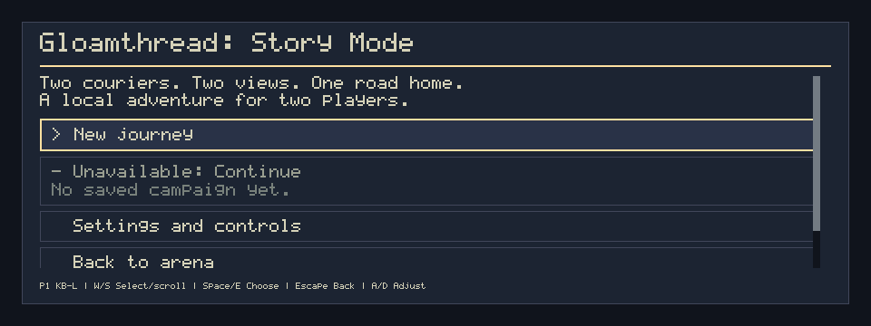
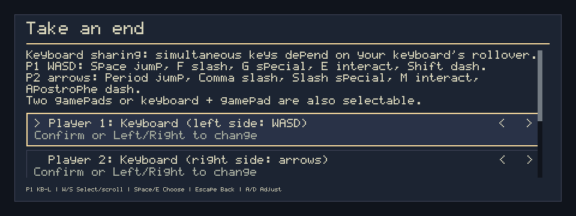
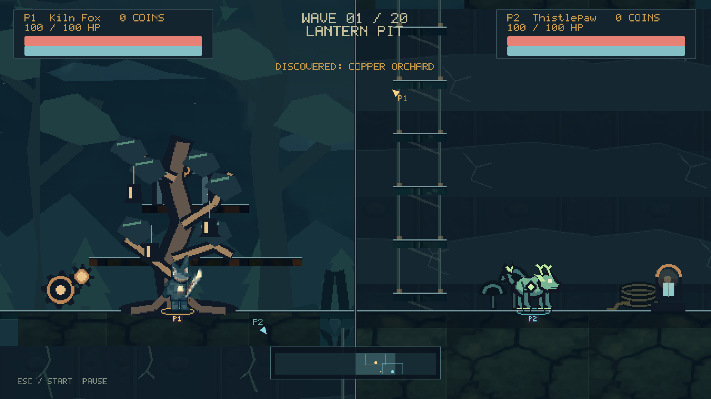
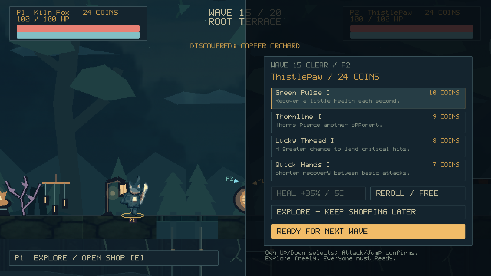
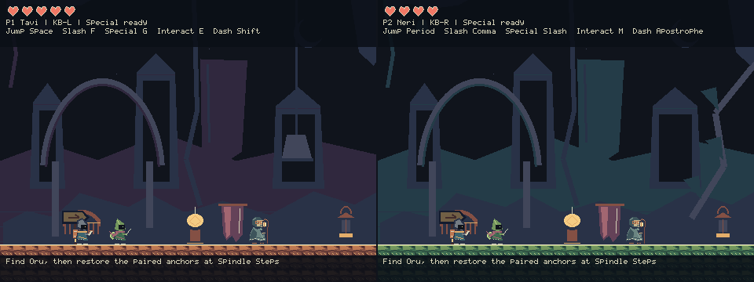
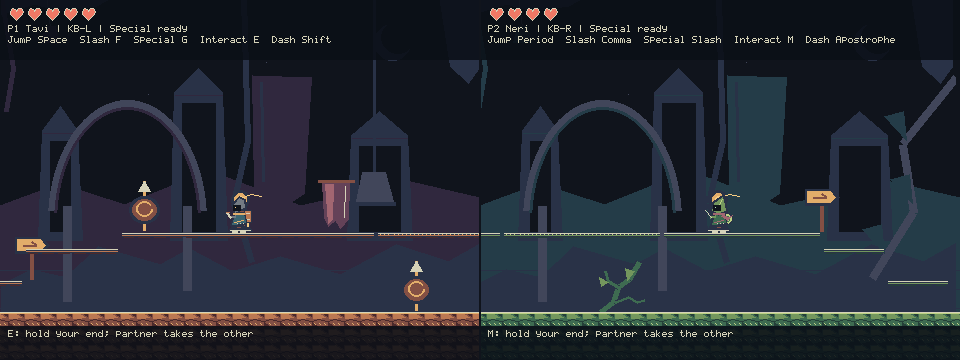
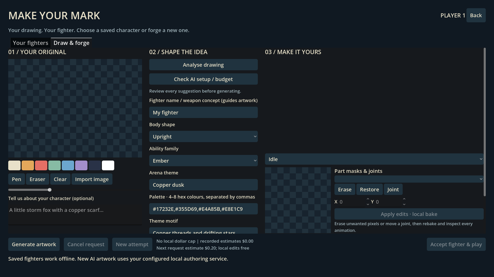
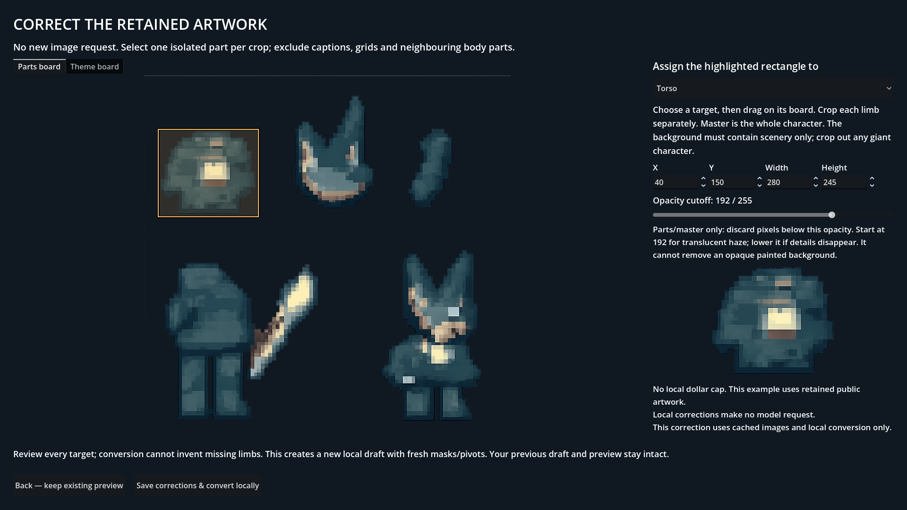

# Gloamthread player guide

Choose a mode, give each player a distinct input, and start playing. **Arena** is a solo or two-player wave fighter with custom characters, exploration and personal upgrades. **Story Mode** restores the original two-player adventure with Tavi and Neri, paired bridges and the Lantern Loom.

This guide targets the build with **STORY MODE (2 PLAYERS)** on its home screen. Earlier arena-only downloads do not contain that menu entry. This project follows **Devin Hack Kochi** event guidance.

## 1. Launch the game

### Run this source checkout from any directory

Use Godot **4.7.2 standard**. The absolute project path prevents Godot from opening an unrelated project when your terminal is elsewhere:

```sh
godot --path "/home/midhun/Coading/Gloamthread"
```

After a fresh checkout, import its resources once before launching:

```sh
godot --headless --path "/home/midhun/Coading/Gloamthread" --editor --import --quit
godot --path "/home/midhun/Coading/Gloamthread"
```

For an Arena window instead of fullscreen:

```sh
godot --path "/home/midhun/Coading/Gloamthread" --windowed --resolution 1920x1080
```

### Run an extracted Linux package

Extract the **whole ZIP** into a writable folder. Open a terminal in that folder:

```sh
chmod +x ./Gloamthread.x86_64
./Gloamthread.x86_64
```

You can also run the executable by its absolute path from another directory. Keep `authoring/` beside it if you want optional generation. Playing built-in or already accepted fighters needs no installed Godot, Python, account, API key or network connection.

The package targets Linux x86_64 with OpenGL Compatibility rendering. If automatic display selection fails, try `./Gloamthread.x86_64 --display-driver wayland` on Wayland or `--display-driver x11` on X11. Arena supports **F11** to toggle fullscreen. Story uses its original 960×360 logical split-screen layout; returning to Arena restores its 1920×1080 presentation. Letterboxing preserves the pixel-art proportions.

## 2. Choose a mode



| Choice | Players | What you do | What carries forward |
| --- | --- | --- | --- |
| **SOLO RUN** | One | Choose an Arena fighter and survive waves. | Accepted fighters, settings and recorded scores. |
| **LOCAL CO-OP** | Two | Share the scrolling Arena, with separate coins and shops. | Accepted fighters, settings and recorded scores. |
| **STORY MODE (2 PLAYERS)** | Two | Play the eight-room Tavi/Neri adventure. | Saved checkpoint and shared story progress. |
| **CHARACTER FORGE** | Menu workflow | Draw/import, generate, correct and accept an Arena fighter. | Accepted creations in **Your fighters**. |

Arena coins and purchased run upgrades reset when the run ends or restarts. Story has its own checkpoint progression. A generated fighter belongs to Arena; Story keeps its fixed couriers and shared traversal unlocks.

In Story, **Return to title** opens the Story menu. **Back to arena** on that menu returns to the Arena home. During a journey, **Save and return to arena** is the direct route back; resolve any visible save error before leaving.

## 3. Inputs, menus and joining

One person can use the left keyboard zone and another the right zone. You can instead select connected gamepads, or combine a keyboard zone with a gamepad. **Each active player needs a different input source.** Two players cannot own the same gamepad or keyboard zone.

Arena home/lobby menus belong to Player 1. In the lobby, use **CHANGE FIGHTER**, **DRAW / IMPORT** and each **P1/P2 INPUT** button, then choose **START RUN**. The roster stays fixed during that run. Mouse selection is available.



Story's **New journey** or **Continue** opens its join screen. Choose the inputs, optionally swap Tavi/Neri for a new journey, then select **Begin journey** or **Continue journey**. The displayed menu owner operates shared Story menus; use Up/Down, Jump or Interact to confirm, and Pause to go back.





The tables below show defaults. Remapped controls shown in-game take precedence. Gamepad names use Xbox-style labels; your controller may print different symbols. If simultaneous keyboard actions fail, try another binding or a gamepad: some keyboards cannot report every key combination.

### Arena controls

| Action | P1: left keyboard | P2: right keyboard | Gamepad |
| --- | --- | --- | --- |
| Move | A / D | Left / Right arrows | Left stick / D-pad |
| Jump | Space | Period `.` | A |
| Drop through a plank | S + Space | Down + Period | Down + A |
| Basic attack: hold to repeat | F | Comma `,` | X |
| Special ability | G | Slash `/` | B |
| Dodge | Left Shift | Apostrophe `'` | RB / right trigger |
| Hold to revive; reopen your shop during a break | E | M | Y |
| Pause | Escape | Enter | Start |

### Story controls

| Action | P1: left keyboard | P2: right keyboard | Gamepad |
| --- | --- | --- | --- |
| Move | A / D | Left / Right arrows | Left stick / D-pad |
| Jump | Space | Period `.` | A |
| Slash: press for a swing | F | Comma `,` | X |
| Courier special | G | Slash `/` | B |
| Interact / activate an anchor / hold revive | E | M | Y |
| Threadstep: after the boss unlock | Left Shift | Apostrophe `'` | RB / right trigger |
| Pause | Escape | Enter | Start |
| Map and current objective | Tab | Semicolon `;` | Select / Back |

**Shift means different things in the two modes:** Arena dodge is available during a run; Story Threadstep unlocks after defeating the Spoolwarden. Pressing it before that story unlock does not open the gated route.

## 4. Arena: your first run

Start with a built-in fighter and learn movement, a held basic attack and the manual special. Appearance and body shape do not grant extra movement: a floating-looking fighter still follows the game's jump and collision rules.

Six ability families give you different starting tools:

| Family | Play around |
| --- | --- |
| Ember | Cleaves, flame and burn. |
| Frost | Bolts, freezing and shatter opportunities. |
| Storm | Fast strikes, chains and charge. |
| Stone | Heavy hits, slams and armour. |
| Nature | Thorns, roots and regeneration. |
| Shadow | Slashes, piercing and marks. |

### Waves, the HUD and finding the last enemy

Clear **20 waves**, with bosses at **5, 10, 15 and 20**. After the twentieth wave, the victory flow offers endless play. Watch your HP, personal coin count, special recharge and the current wave; a boss has its own health display.

The wave number is progression, not a count of enemies standing on-screen. Living enemies can be outside your view, while queued enemies or visible arrival warnings can still be pending. A wave clears only when the queue, arrivals and living enemies are all finished. Use the minimap, offscreen/final-enemy cues and nearby paths if the screen looks empty. Moving far away does not erase an enemy or award its coins.

### Explore the growing world

The world starts four screens wide and adds four more after waves **5, 10 and 15**, reaching sixteen. Earlier terrain and discoveries remain. Explore raised paths and shallow caves; the frontier marks the current boundary.

Nearby co-op partners share a view. Exploring apart splits it into **P1 left / P2 right** without teleporting either player. A downed partner remains a camera target. Personal shops can also force a split while open.



*This retained native scene illustrates the scrolling views; it is not a fresh human playthrough.*

Each region contains **four caches** and **two healing plants**. Attack a cache to open it: it pays **three coins to each active player**, once per run. A plant restores **20% health to its collector** when healing is needed. Loot does not refill just because a camera moves away. Passive regeneration applies during combat, not free intermission exploration.

### Coins, shops and Ready

Enemy last hits award personal coins; projectiles, chains and damage over time keep their source player. Everyone receives a wave-clear bonus. A cosmetic coin trail does not let your partner steal the reward.

Between waves, each player gets an independent panel with four upgrade offers, healing, a free reroll, Explore and Ready. Read the shown effect, price and rank before buying. Upgrades change this run's build; they do not permanently change your saved fighter.



*This retained native scene illustrates independent shopping and exploration.*

1. Use your own Up/Down to select; Attack or Jump confirms.
2. Buy an upgrade or **HEAL +35% / 5C** if affordable and needed.
3. Use your one free reroll for that wave if the offers do not fit your build.
4. Choose **EXPLORE - KEEP SHOPPING LATER** to move around without starting the next wave.
5. Press your Interact key to reopen your shop; doing so clears your Ready state.
6. Choose **READY FOR NEXT WAVE** when finished. Every active player must explicitly become ready.

### Read enemy attacks

| Enemy | Response to practise |
| --- | --- |
| Swarm / chaser | Keep space and avoid getting surrounded. |
| Charger | Leave its marked rush lane, then punish the miss or wall recovery. |
| Heavy | Bait its swing, flank its guarded front, or use control/stagger. Teal broken brackets indicate vulnerability. |
| Shooter | Move off the announced burst line or use solid cover; it commits to its aim. |
| Flyer | Leave the marked landing point before the dive, then punish its retreat. Open planks do not stop it; solid terrain does. |

Amber indicates a tell; red indicates approaching activation. Read a boss's tell before closing in. More detail is in [Enemy mechanics and counterplay](ENEMY_MECHANICS.md).

### Arena defeat and revival

In co-op, stand near a downed partner and hold Interact for **1.5 seconds**. Downed players also return on wave completion. Arena has **no Story-style twelve-second downed timeout**. Solo death or a team wipe ends the run. Restarting resets run coins and upgrades; accepted fighters remain saved.

## 5. Story Mode: the road to the Lantern Loom

Story is a **two-player** adventure with a fixed split screen and two colour treatments of one shared world. Tavi has the short-range **Ember Arc** special; Neri sends a **Spore Bolt**. Your character selection can be swapped at the start of a new journey. Your input source still belongs to your player slot.



*Fresh restored-mode capture in Lantern Rest. The title → join → first room → save-and-return flow was exercised; this image does not establish a new full eight-room playthrough.*

### Cooperation essentials

- **Leaving a room:** both living couriers must stand in the exit rally area; then one presses Interact. One courier alone cannot replace the room.
- **Restoring a bridge:** take two different anchors, one per courier, and press Interact at your own end. Each activation latches while the partner reaches the other end. There is no frame-perfect synchronisation requirement. Both players can use either anchor.
- **Reviving:** stand close and hold Interact for 1.5 seconds. Taking damage interrupts the rescuer. A downed courier has **12 seconds of simulation time**; both players down, or the timer expiring, returns the team to its checkpoint.
- **Pause and Map:** these hold the shared story world. Check the current objective and checkpoint if you lose the route.



*Retained original campaign route capture; bridge progress belongs to the team.*

### Eight-room walkthrough

| Room | What to do | What opens next |
| --- | --- | --- |
| **r00 — Lantern Rest** | Meet Oru, read the arrival guidance and activate checkpoint A. Practise jump, slash and specials before leaving together. | Mossfoot Atrium. |
| **r01 — Mossfoot Atrium** | Continue toward Spindle Steps. Remember the branch that needs Threadstep; you will return after the boss. | The first bridge route. |
| **r02 — Spindle Steps** | Climb the forgiving steps and restore the bridge with two distinct anchors. Rally together beyond it. | Glasswing Gallery. |
| **r03 — Glasswing Gallery** | Learn the ground and flying enemies; use both specials. Explore the optional lantern-charm pocket if you wish. | Warden's Landing. The charm is optional, not an ending requirement. |
| **r04 — Warden's Landing** | Activate checkpoint B before the boss route. Regroup and make sure both players are ready. | Broken Bell. |
| **r05 — Broken Bell** | Defeat the Spoolwarden by respecting its tells and striking during openings. | Shared Threadstep and the shortcut back toward the Atrium. |
| **r06 — Severed Causeway** | Return through the shortcut, take the Atrium's remembered dash route, practise Threadstep and restore the second anchor pair. | Lantern Loom. |
| **r07 — Lantern Loom** | Each courier takes a different restoration station and interacts. After restoration, take the return route together. | Return to Lantern Rest for the ending. |

**Boss teamwork:** when one courier staggers the Spoolwarden, a hit from the other courier can trigger the optional **Cross-stitch** follow-up. It uses your normal attacks; there is no separate secret key. The bonus is helpful, not required to unlock Threadstep.

**After the ending:** keep exploring, return to the Story title, or start a new journey with the characters swapped. Checkpoint recovery keeps permanent shared restorations. **Continue** resumes at a validated checkpoint, not an arbitrary mid-jump position.

## 6. Make an Arena fighter



Built-ins and accepted fighters work offline. Optional **Analyse** and **Generate** use your API account; local cropping, masks, pivots, rebaking and acceptance do not send another model request.

### Set up optional authoring

For an extracted package, run this from its folder:

```sh
bash setup_authoring.sh
authoring/.venv/bin/python authoring/tools/fighter_forge.py status
```

Add your own `OPENAI_API_KEY` locally in `authoring/.env`. Setup preserves an existing file and never prints its key. For this source checkout:

```sh
cd "/home/midhun/Coading/Gloamthread"
python3 -m venv --system-site-packages .venv
.venv/bin/python -m pip install -r requirements-authoring.txt
.venv/bin/python tools/fighter_forge.py status
```

Source authoring reads the private `.env` in that checkout. Keep an existing key file intact. The status command reports configuration safely without making a model request.

There is **no local total or per-character dollar cap**. Earlier allowance settings no longer block generation. Recorded request estimates and uncertain outcomes remain history, not billing receipts. Analyse/Generate are deliberate actions; automatic retries and model fallback remain disabled. Provider account limits can still reject a request. Cancellation stops later work but cannot guarantee that a request already in flight was unbilled.

### Draw → review → generate → accept

1. Open **CHARACTER FORGE**, or **DRAW / IMPORT** for the desired lobby player.
2. Enter your preferred **Fighter name** and describe its body, colours and **weapon concept (guides art)**. Draw on the canvas or import your own PNG/JPEG. Keep the preferred name explicit so it can be retained in the proposal.
3. Choose Analyse for a suggested design, or enter the settings yourself. Review the name, upright/four-legged/floating body, theme and suggested ability family before generating.
4. Choose Generate when those settings are right. The drawing informs appearance and suggestions; combat still uses the six supported families. A weapon description does not create arbitrary new attack code or grant flight.
5. Inspect the returned animation preview, including run, attacks, downed and revive poses. Check that the silhouette and theme remain readable in motion.
6. If needed, select a part, use **Erase**, **Restore** or **Joint**, then **Apply edits · local bake**. Inspect the new animation again.
7. Choose **Accept fighter & play**. This saves the validated bundle in **Your fighters** and opens the lobby with that fighter selected. Choose **START RUN** to enter combat.

Conversion and acceptance are separate. A successful conversion creates a preview; it does not by itself install the fighter. Cancelling or rejecting a candidate preserves accepted fighters.

A swordsman concept can suggest **Stone**; you can override that suggestion before generating. Choose the ability family for the attacks you want, rather than assuming a drawn weapon creates a seventh combat family.

### Recover a returned image layout locally



If a generated board does not match the expected arrangement, use **Correct cached layout** instead of generating it again:

1. Select each body part and drag a rectangle around its visible artwork. Include the complete-character **master** crop too.
2. Review the background and material crops. Keep scenery out of the character pieces.
3. Adjust the opacity cutoff if faint haze surrounds the artwork. Every part and the master must still contain visible pixels above that cutoff.
4. Save and convert. A simple click without dragging preserves the previous crop. An empty crop remains selected in the editor with an explanation; correct it rather than repeatedly saving unchanged inputs.
5. Review the animation preview, make any part-mask/joint edits, then **Accept fighter & play**.

This uses retained raw images in a local correction draft and makes no new image request. If parts have already been converted, changing their original crop recipe requires a new local correction draft; it must not silently leave the old part pixels in place. Keep the earlier preview until the corrected one is ready.

## 7. Saves, offline play and leaving safely

| Data | Behaviour |
| --- | --- |
| Arena coins, upgrades, current wave and run power | Reset with a new/restarted run; there is no promised mid-run Continue. |
| Accepted fighters | Stored locally and reusable offline. |
| Forge drafts and cached images | Retained locally for review/recovery. |
| Settings and recorded scores | Stored separately from temporary run power. |
| Story campaign | Shared progress saved through checkpoints; Continue validates it before loading. |

Godot stores player data in its per-user application-data directory, not beside the executable. Forge's `fighters/` and `forge_jobs/` contain accepted characters and drafts. Optional authoring keeps its request-accounting history below its own `build/forge/` folder. Preserve these files when moving installations; never upload private drawings or a key file as a bug-report attachment.

Story saves keep a validated previous-save backup. If the game offers backup recovery, read the message and choose it explicitly. If a save fails, play can remain open: retry after fixing storage permissions/space. The Story title/exit flow distinguishes retrying from explicitly discarding unsaved progress. Starting a new journey can replace the current campaign, so use Continue when you intend to resume.

## 8. Troubleshooting

| Problem | What to check |
| --- | --- |
| Godot opens another project or says no project exists | Use the absolute `--path "/home/midhun/Coading/Gloamthread"` command above. |
| Story Mode is missing | You may be running an older arena-only package. Use the build whose home has **STORY MODE (2 PLAYERS)**. |
| One player cannot move or confirm | Check that player's assigned input. Shared menus have an owner; personal shops use each player's own controls. |
| Two keyboard players lose simultaneous actions | Test different bindings or use a controller; keyboard rollover varies by hardware. |
| A controller disconnects | Reconnect it or select a free input on the recovery screen, then resume deliberately. Held buttons may need releasing first. |
| Arena has not cleared although your view is empty | Check for offscreen enemies and arrival warnings. A wave needs no queued, arriving or living enemies. |
| An Arena player cannot move between waves | Their own shop is still open. Choose Explore; Interact reopens it later. |
| Story exit or bridge does nothing | For an exit, rally both living couriers. For a bridge, activate two different anchors, one per courier. |
| Story dash does nothing | Defeat the Spoolwarden first. Threadstep is a shared story unlock. |
| Forge says tools/Python are unavailable | Keep `authoring/` beside the package and run its setup helper, or install the source authoring dependencies. |
| Analysis/generation reports key, model, account or quota failure | Check the private configuration and the actual provider account. Do not repeatedly submit an uncertain request; built-ins and accepted fighters remain playable. |
| Save/convert keeps returning to the crop editor | Read the visible crop error, select its part/master and adjust the rectangle or cutoff. Saving unchanged empty pixels cannot fix it. |
| Converted fighter is not in the lobby | Finish preview review and choose **Accept fighter & play**; conversion alone is not acceptance. |
| Required assets fail validation or scenery is missing | Re-extract a complete matching package. For source, import resources with Godot 4.7.2; do not mix files from different releases. |

## Evidence and feedback

Screenshots illustrate real captured game states. The retained Arena shop/split scenes are controlled native setups. Story title/join/Lantern Rest images cover the freshly restored entry flow; the bridge image comes from the original campaign route. They do not establish a fresh full human playthrough of the combined mode-switch build.

For the current implementation, exact checks and limitations, see [STATUS.md](STATUS.md). Physical gamepads/hotplug, keyboard hardware rollover, fresh-human balance, listening quality and other hardware/distributions remain separate acceptance questions. When reporting a problem, include the mode, version/commit from the package's `BUILD.json`, player/input assignments, what you pressed and what happened. Keep credentials and private artwork out of shared logs or screenshots.

### Latest source: use the complete illustrated design

New generations create a complete illustrated character, used directly for the playable sprite and portrait. The 32 poses transform that whole cutout rather than squeezing its limbs into starter shapes. For an older draft, **Use detailed character cutout PNG** imports a transparent full-character PNG (32–2048 pixels per side, at most 8 MB); it creates a fresh local correction draft, retaining the older job. Edit the Master mask/pivot in the preview and use cached layout correction for scenery/material crops. An opaque background crop requires a genuine transparent cutout first.

Wizard/mage/sorcerer/other magical identities use projectile kits; sword/spear/axe fighters use melee kits. Name and description guide new proposals, and the runtime also corrects incompatible kits on older named fighters. Manual choices stay within the compatible category. No new image requests are made by cutout import or local rebaking.
