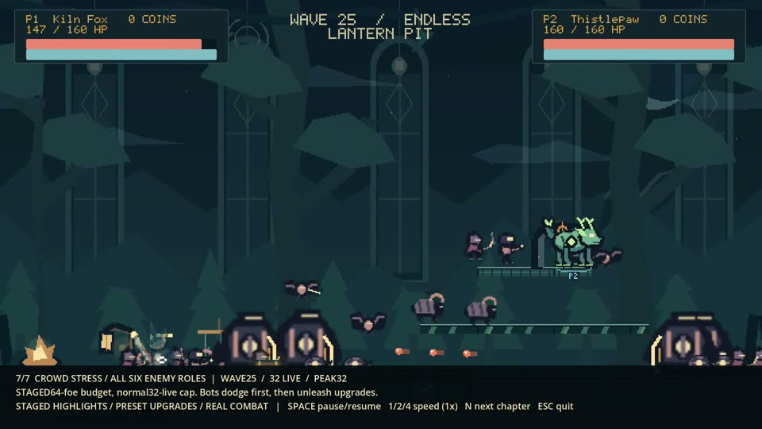
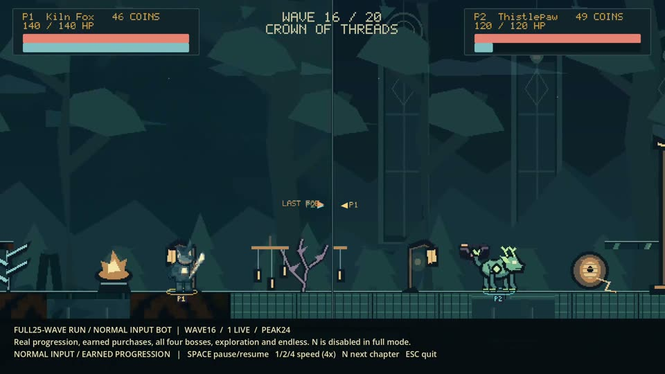
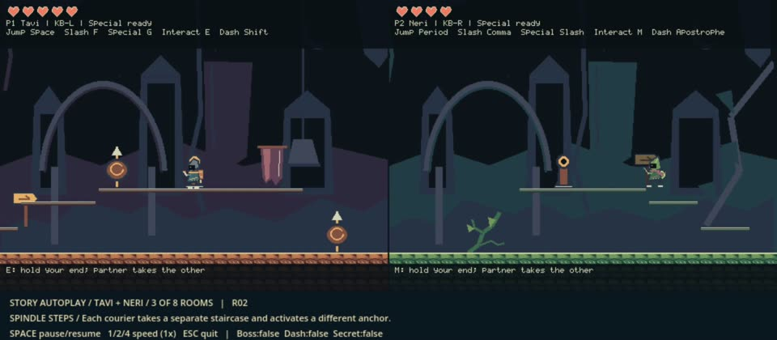
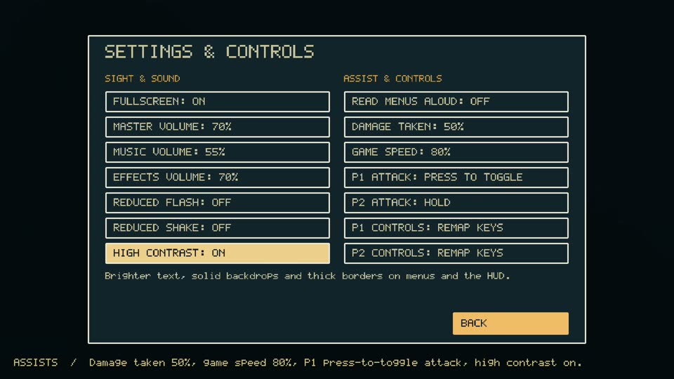

# Videos

Five videos show Gloamthread without installing anything. All are hosted on the [videos release](https://github.com/9MidhunPM/GloamThread/releases/tag/videos-2026-10-26) as MP4 files (H.264 video, AAC audio, 1080p) that play in any browser. The intro is also stored in this repository.

| Video | Length | Size | Kind |
| --- | --- | --- | --- |
| [Intro](#intro) | 0:48 | 3.2 MB | Story introduction, captioned |
| [Arena highlights](#arena-highlights) | 2:23 | 27.5 MB | Real engine capture of `./showcase.sh` |
| [Full 25-wave run at 4×](#full-25-wave-run-at-4) | 7:57 | 81.2 MB | Real engine capture of `./showcase.sh --full --speed 4` |
| [Entire Story Mode](#entire-story-mode) | 3:51 | 14.6 MB | Real engine capture of `./story_showcase.sh` |
| [Accessibility tour](#accessibility-tour) | 1:01 | 3.3 MB | Real engine capture of `tools/accessibility_tour.gd` |

The gameplay videos are **automated demos driven by the game's own bots**, not human play, and are not edited. Every frame comes from Godot's Movie Maker rendering the real game at a fixed 30 frames per second with the game's own audio. How each was made, with commands and run reports: [recording evidence](../evidence/recordings/README.md).

## Intro

[](https://github.com/9MidhunPM/GloamThread/releases/download/videos-2026-10-26/gloamthread-intro.mp4)

**[Watch the intro](https://github.com/9MidhunPM/GloamThread/releases/download/videos-2026-10-26/gloamthread-intro.mp4)** · [repository copy](media/gloamthread-intro.mp4) · 48 seconds · 1280×720 · captions burned in.

A short motion piece introducing Story Mode's world and couriers. It was supplied by the project owner; its embedded metadata describes it as an *original motion composition using Gloamthread repository assets; not gameplay footage*. It has a soundtrack, which has not been reviewed for this document.

### Transcript

Times are approximate.

| Time | On screen | Caption |
| --- | --- | --- |
| 0:00 | Lanterns along a road, a thread of light running between them. | Once, the roads remembered the way home. |
| 0:05 | The thread frays and the lanterns dim. | Then the seams began to unravel. |
| 0:12 | **TAVI, Ember Courier**, on warm brick beside a brass lantern. | One remembers furnaces and brass. |
| 0:17 | **NERI, Moss Courier**, on mossy ground in the rain. | One remembers roots and rain. |
| 0:23 | Tavi and Neri stand on one road drawn in both palettes, linked by the thread. | One kingdom. Two ways of seeing. Opposite ends of the last living thread. |
| 0:33 | The Lantern Loom; the keeper **Oru** speaks. | “The far district is still there. The way home isn't.” |
| 0:39 | Title: **GLOAMTHREAD — Two Ends. Hold the other end.** The couriers at either end of the thread. | Restore the Lantern Loom. Find the way home. |

## Arena highlights

[](https://github.com/9MidhunPM/GloamThread/releases/download/videos-2026-10-26/gloamthread-arena-highlights.mp4)

**[Watch the arena highlights](https://github.com/9MidhunPM/GloamThread/releases/download/videos-2026-10-26/gloamthread-arena-highlights.mp4)** · 2:23 · seven labelled chapters.

Two bot-driven fighters (Kiln Fox and Thistlepaw) in co-op: wave 1 combat, kill rewards and personal shops, walking apart to split the camera, then the four bosses (Warden, Artillery, Tempest, The Loom), endless wave 25, and a staged 64-enemy finale held at the normal 32-enemy live cap. A caption bar names each chapter. Chapters jump to their wave and apply preset upgrades, which the caption states; this is a tour of mechanics, not a normal run.

## Full 25-wave run at 4×

[](https://github.com/9MidhunPM/GloamThread/releases/download/videos-2026-10-26/gloamthread-arena-full25-4x.mp4)

**[Watch the full run](https://github.com/9MidhunPM/GloamThread/releases/download/videos-2026-10-26/gloamthread-arena-full25-4x.mp4)** · 7:57 at four times normal speed.

One continuous co-op run with normal progression: no wave jumps or preset upgrades. The bots earn coins, buy upgrades, explore all four regions as the world grows, beat all four bosses, win wave 20 and continue to endless wave 25. Played at 4× so the whole run fits in eight minutes; the game simulates the same 60 steps per game-second. Between some waves the bots wander for a while: their scripted exploration trips after waves 1, 2, 5 and 15 did not reach their targets and timed out, so the run report marks the route incomplete even though the game itself played through to wave 25 with no errors and no player downed. The same route passes when run headless at normal speed.

## Entire Story Mode

[](https://github.com/9MidhunPM/GloamThread/releases/download/videos-2026-10-26/gloamthread-story-full.mp4)

**[Watch the entire Story](https://github.com/9MidhunPM/GloamThread/releases/download/videos-2026-10-26/gloamthread-story-full.mp4)** · 3:51 at normal speed.

A new journey from Lantern Rest to the ending: Oru's dialogue, both checkpoints, the paired-anchor bridges, the Glasswing Gallery fight and hidden lantern charm, the Spoolwarden boss, the earned Threadstep dash, the Lantern Loom and the walk home. Both couriers play in the original side-by-side views with a viewing banner below. Dialogue advances through the real Continue action with reading time.

## Accessibility tour

[](https://github.com/9MidhunPM/GloamThread/releases/download/videos-2026-10-26/gloamthread-accessibility.mp4)

**[Watch the accessibility tour](https://github.com/9MidhunPM/GloamThread/releases/download/videos-2026-10-26/gloamthread-accessibility.mp4)** · 1:01.

Walks through every option in **SETTINGS & CONTROLS** with its on-screen explanation, turns on three assists and high contrast, remaps Jump to K and resets it, then starts a run in which one Attack press keeps attacking (the HUD shows AUTO-ATTACK) at 50% damage taken and 80% speed. A caption bar explains each step. Narration is off in this video. Read the [Accessibility guide](ACCESSIBILITY.md) for every option.

## Make your own

From a source checkout ([setup](../README.md#play-in-three-steps)):

```sh
./showcase.sh --record arena-highlights.ogv
./showcase.sh --full --speed 4 --record arena-full25.ogv
./story_showcase.sh --record story-full.ogv
godot --path . --write-movie accessibility.ogv --fixed-fps 30 --windowed --resolution 1920x1080 --script tools/accessibility_tour.gd
```

Recording renders every frame, so it can take longer than the video's length. Demos use temporary saves and never change yours.
